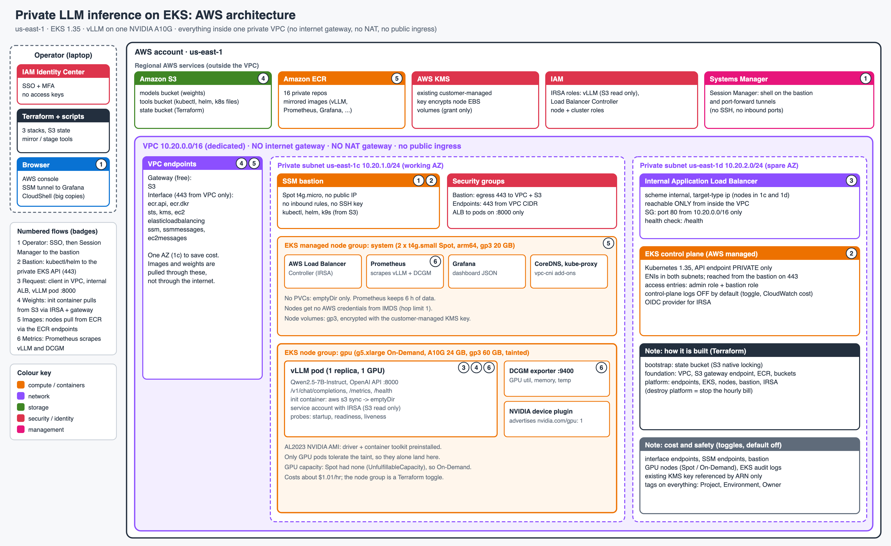
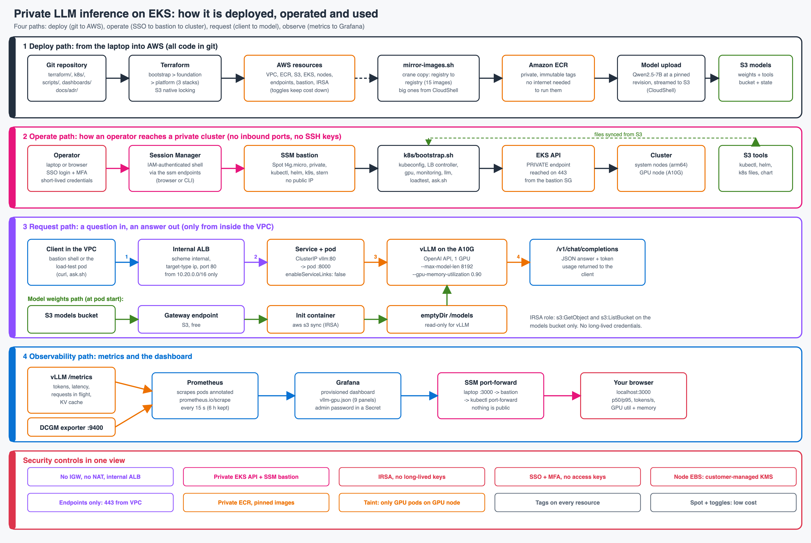
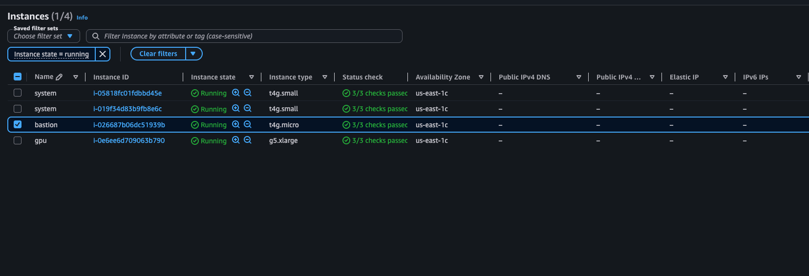
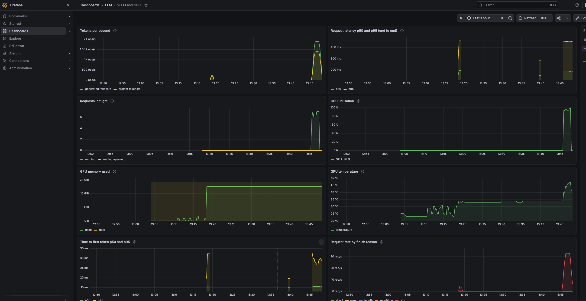

# Private LLM inference on EKS

Serves **Qwen2.5-7B-Instruct** with vLLM on one NVIDIA A10G, inside a private VPC on Amazon EKS. Everything is Terraform and Kubernetes manifests. The endpoint is reachable only from inside the VPC, and it is monitored with Prometheus, the NVIDIA DCGM exporter and Grafana.

- **API:** OpenAI-compatible `POST /v1/chat/completions` behind an **internal ALB**.
- **Private:** no internet gateway, no NAT, no public ingress. Images come from private ECR and weights from S3, through VPC endpoints.
- **Access:** pods use IRSA (no long-lived keys), people use SSO, and the EKS API is private, reached through an SSM bastion.
- **Walkthrough video:** shared separately.

## Architecture




Running instances (AWS console): two system nodes, the bastion and the GPU node, all in us-east-1c with no public IP.



## Results
Load test from a pod in the cluster, through the internal ALB, 128 output tokens per request:

| Model | Requests / concurrency | Throughput | Latency p50 / p95 | Errors |
|---|---|---|---|---|
| Qwen2.5-7B-Instruct | 200 / 8 | 4.7 req/s, 228 tokens/s | 1.69 s / 1.86 s | 0 |

GPU memory in use: 19.8 GiB of 22.5 GiB. Raw output: [phase5-7b-and-loadtest.txt](docs/evidence/phase5-7b-and-loadtest.txt). GPU proof (`nvidia-smi` from a pod on the GPU node): [phase3-nvidia-smi.txt](docs/evidence/phase3-nvidia-smi.txt).

Grafana dashboard during the 7B run: requests in flight reach 8, GPU utilisation hits 100%, GPU memory stays near 19 GiB, latency p50 and p95 are about 1.75 s and 1.97 s.



## Deploy from scratch
Needs an AWS account with SSO, GPU quota (4 vCPU) in us-east-1, Terraform 1.11 or newer, AWS CLI, kubectl, helm, crane and docker. Full commands are in [docs/runbook.md](docs/runbook.md).

| Step | What |
|---|---|
| 1 | `terraform apply` in `terraform/bootstrap`, then `terraform/foundation` (VPC, ECR, S3) |
| 2 | `scripts/mirror-images.sh` and `scripts/stage-tools.sh` (copy big images from AWS CloudShell) |
| 3 | `scripts/upload-model-stream.sh <models-bucket>` (7B weights, from CloudShell) |
| 4 | `terraform apply` in `terraform/platform` with `enable_gpu_ondemand_nodes = true` (hourly billing starts) |
| 5 | `scripts/stage-k8s.sh`, then on the bastion `~/k8s/bootstrap.sh`, then `bootstrap.sh gpu`, `monitoring`, `llm` |

**Destroy:** `terraform destroy` in `terraform/platform` stops the hourly bill. `foundation` (S3, ECR) costs cents per month.

## Run the load test
On the bastion (the endpoint works only from inside the VPC):
```
~/k8s/ask.sh "Explain why private networking matters"        # one question, prints the answer
~/k8s/bootstrap.sh loadtest                                    # 200 requests, concurrency 8
REQUESTS=600 CONCURRENCY=8 ~/k8s/bootstrap.sh loadtest         # change the two numbers
```
On the 7B model: 200 requests take about 43 s and 600 about 2 min. The result prints as JSON.

## vLLM settings
| Argument | Value | Why |
|---|---|---|
| `--model` | `/models` | weights synced from S3, no internet download |
| `--served-model-name` | `qwen2.5-7b-instruct` | stable API name |
| `--max-model-len` | `8192` | KV cache fits beside 15 GB of weights on 24 GB |
| `--gpu-memory-utilization` | `0.90` | headroom for CUDA graphs |
| `--tensor-parallel-size` | `1` | one A10G |

Model revision: Hugging Face `Qwen/Qwen2.5-7B-Instruct` at `a09a35458c702b33eeacc393d103063234e8bc28`. Pod: 1 GPU, 2 CPU and 8 GiB requested, 13 GiB limit.

## Probes: readiness vs liveness
- **Readiness:** "can it take traffic now?" On failure the pod leaves the Service and the ALB, but is not restarted.
- **Liveness:** "is it still alive?" On failure the container is restarted.
- **Startup:** gives vLLM up to 15 minutes to load the model before liveness starts.

## Known limitations
- **GPU runs On-Demand.** Spot `g5.xlarge` had no capacity (`UnfulfillableCapacity`), even with g6, g4dn and a second AZ. The Spot group stays in code behind `enable_gpu_nodes`. ([ADR-001](docs/adr/ADR-001-instance-type-and-capacity-model.md))
- **EKS control-plane logging and the `logs` VPC endpoint are off by default** to avoid CloudWatch cost; `enable_eks_control_plane_logs` turns logging on. No CloudTrail trail. ([ADR-004](docs/adr/ADR-004-security.md))
- **S3 native state locking** instead of DynamoDB (Terraform 1.11 or newer). ([ADR-005](docs/adr/ADR-005-delivery-and-terraform.md))
- **Node disks use an existing customer-managed KMS key** shared with Identity Center, rotation off. Other storage uses default encryption.
- **PoC scope:** one replica, one working AZ, plain HTTP inside the VPC, no authentication in front of vLLM. [What I would change for a law firm](docs/law-firm-answer.md).

## More
[Decisions (ADRs)](docs/adr/) · [Security controls](docs/security.md) · [Runbook](docs/runbook.md) · [Law-firm answer](docs/law-firm-answer.md)

```
terraform/   bootstrap (state), foundation (VPC, ECR, S3), platform (EKS, nodes, bastion), modules
k8s/         manifests and bootstrap.sh (runs on the bastion)
dashboards/  Grafana dashboard JSON
scripts/     image mirroring, tool staging, model upload
loadtest/    load test client
docs/        adr, architecture, evidence, runbook, security, law-firm answer
```
